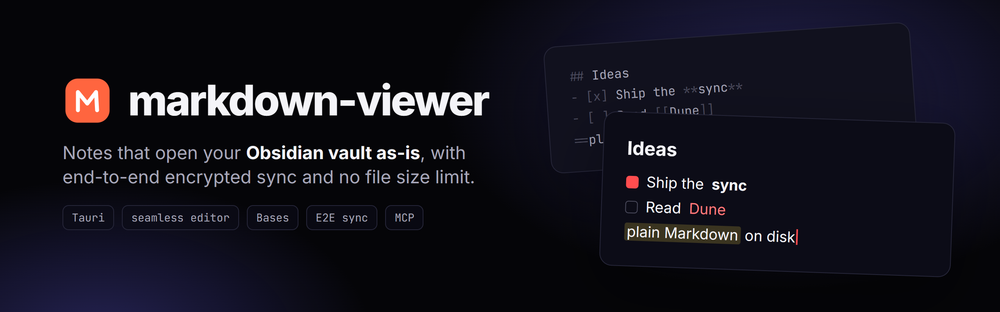
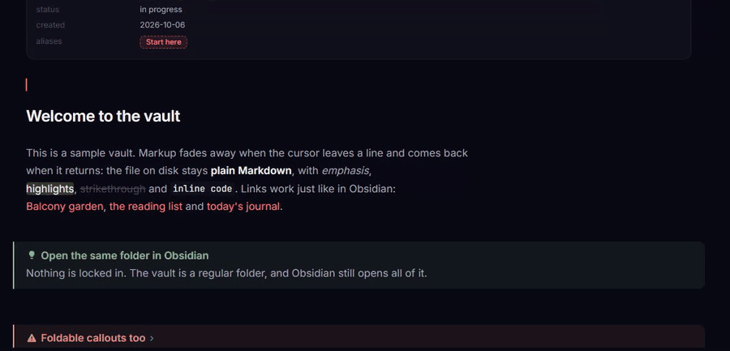
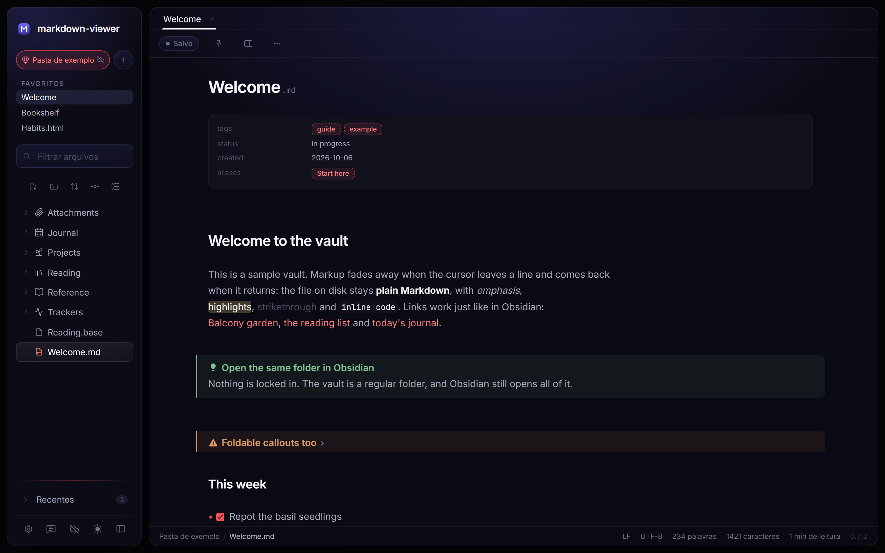
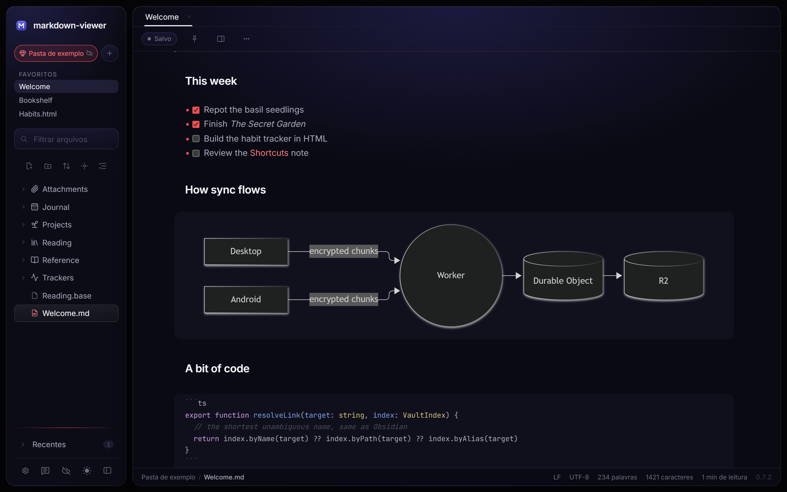
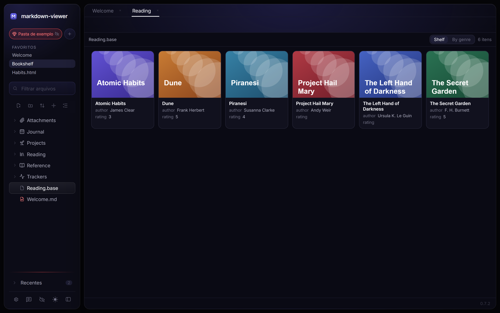
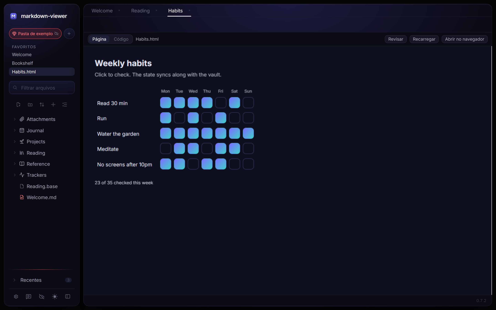
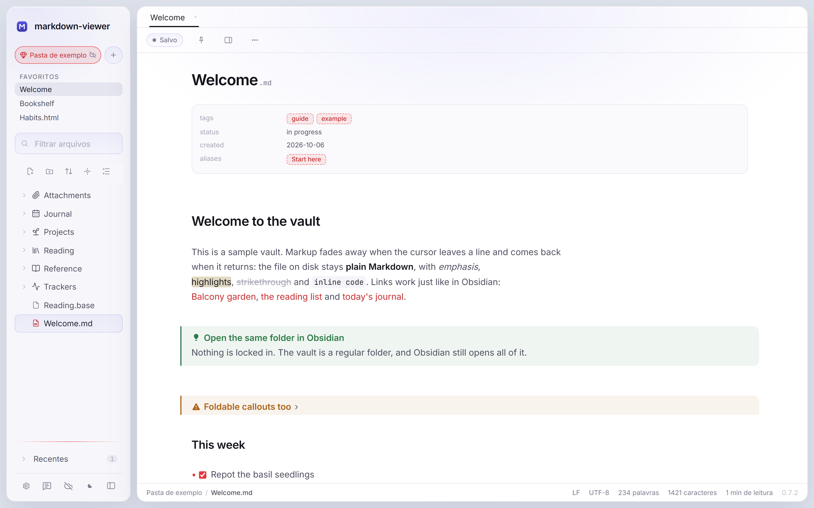
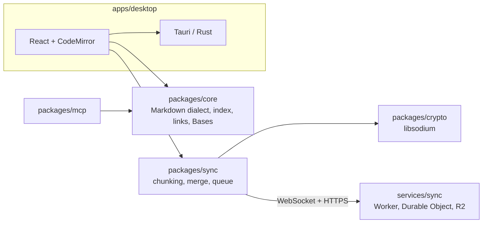

<div align="center">

<picture>
  <source media="(prefers-color-scheme: dark)" srcset=".github/assets/banner-dark.png">
  <source media="(prefers-color-scheme: light)" srcset=".github/assets/banner-light.png">
  
</picture>

<br>

<a href="#stack"></a>

<br><br>

**A local-first notes app that opens your Obsidian vault without breaking anything,**<br>
**and syncs it end-to-end encrypted across devices, with no file size limit.**

[Features](#features) · [Screenshots](#screenshots) · [Getting started](#getting-started) · [Sync](#sync) · [Architecture](#architecture)

<br>



<sub>Seamless editing: the syntax shows on the line you are on and fades everywhere else. The file stays plain Markdown.</sub>

</div>

<br>

> [!NOTE]
> The interface is in Brazilian Portuguese. Everything in the screenshots comes from a
> fictional sample vault that ships with the app (`?demo`).

## Features

|                                   |                                                                                                                                  |
| --------------------------------- | -------------------------------------------------------------------------------------------------------------------------------- |
| 📂 **Your vault, untouched**      | The vault stays a regular folder in the same layout Obsidian uses. If this app disappears tomorrow, Obsidian still opens it all. |
| ✍️ **Seamless editor**            | CodeMirror 6 with live rendering: callouts, tasks, tables, Mermaid, footnotes, `==highlights==`, embeds and transclusion.        |
| 🔗 **Obsidian-grade links**       | `[[note]]`, `[[note#heading]]`, `[[note#^block]]` and aliases resolve exactly like Obsidian. Renaming a file updates every link. |
| 🗂️ **Bases**                      | Reads `.base` files and renders their table and card views, with filters, formulas, grouping and sorting.                        |
| 🌐 **HTML as a first-class note** | HTML files run in an isolated frame, and their `localStorage` is redirected to a file in the vault, so trackers sync too.        |
| 🔒 **End-to-end encrypted sync**  | Content-defined chunks, XChaCha20-Poly1305, three-way merge for text. The server never sees names, paths or content.             |
| 🤖 **MCP server**                 | Lets Claude search, read, query Bases and rename inside the vault, using the same index as the app.                              |
| 📄 **PDF, code and images**       | pdf.js reader with search, syntax-highlighted code, image viewer. Everything else opens in the system app.                       |

## Screenshots



<table>
  <tr>
    <td width="50%"></td>
    <td width="50%"></td>
  </tr>
  <tr>
    <td align="center"><b>Mermaid, tasks and code</b></td>
    <td align="center"><b>Bases</b> · a <code>.base</code> file as cards</td>
  </tr>
  <tr>
    <td width="50%"></td>
    <td width="50%"></td>
  </tr>
  <tr>
    <td align="center"><b>HTML trackers</b> · state saved in the vault</td>
    <td align="center"><b>Light theme</b></td>
  </tr>
</table>

## Getting started

You need **Node.js 22+** and, for the desktop app, the
[Tauri prerequisites](https://v2.tauri.app/start/prerequisites/) (Rust 1.77+).

```bash
npm install

npm run dev           # the interface in the browser, at http://localhost:5273
npm run dev:desktop   # the desktop app (Tauri)
```

> [!TIP]
> Open `http://localhost:5273/?demo` to try it with the in-memory sample vault, no folder
> needed.

<details>
<summary><b>All scripts</b></summary>

<br>

| Command                 | What it does                                        |
| ----------------------- | --------------------------------------------------- |
| `npm run dev`           | Vite dev server for the interface                   |
| `npm run dev:desktop`   | Desktop app with hot reload                         |
| `npm run build:desktop` | Desktop installers for the current platform         |
| `npm run verify`        | Lint (oxlint), typecheck, tests (Vitest) and build  |
| `npm run vault:check`   | Lists links, embeds and aliases that do not resolve |
| `npm run base:check`    | Runs every `.base` in a vault and prints the rows   |

</details>

## Sync

The sync runs on Cloudflare's free tier and you deploy your own copy.

| Piece                          | Role                                                                                  |
| ------------------------------ | ------------------------------------------------------------------------------------- |
| **Worker**                     | Routes each call to the vault's Durable Object                                        |
| **Durable Object** (one/vault) | Authenticates devices, keeps the log in SQLite, orders commits, notifies by WebSocket |
| **R2**                         | Stores the encrypted chunks (10 GB free, no egress fees)                              |

<details>
<summary><b>How it works</b></summary>

<br>

- **Chunks.** Every file is split into content-defined chunks of about 4 MB, so there is
  no size limit, a small edit to a huge PDF uploads only the chunk that changed, and
  transfers resume where they stopped.
- **Encryption.** libsodium on every device: XChaCha20-Poly1305 for content, Argon2id to
  derive keys from the vault password. One random master key per vault, stored on the
  server only when wrapped. Chunk ids are an HMAC of the content, so the server learns
  nothing from them.
- **Conflicts.** Text gets a line-by-line three-way merge against the last common
  version. Only overlapping edits produce a conflict copy next to the file. Binaries keep
  the newest version and the other one stays in history.
- **No accounts.** Each device gets a token when it is paired, by QR code or by the vault
  password, and can be revoked from any other device.

</details>

```bash
cd services/sync
npx wrangler login
npm run deploy
```

See [`services/sync`](services/sync) for the setup code and the secrets the Worker expects.

## MCP server

[`packages/mcp`](packages/mcp) reads the vault straight from disk, with the same index as
the app, and does not need the app to be open.

| Tool              | What it does                                                    |
| ----------------- | --------------------------------------------------------------- |
| `search`          | Search notes and HTML, with `#tag`, `path:`, `"phrase"`, `-not` |
| `get_note`        | Properties, aliases, tags, headings, links, backlinks, content  |
| `resolve_link`    | Where a `[[link]]` points, the Obsidian way                     |
| `backlinks`       | Who links to a file                                             |
| `query_base`      | Runs a `.base` and returns its rows                             |
| `list_tags`       | Tags with counts                                                |
| `list_properties` | Properties with counts, or the values of one                    |
| `rename`          | Renames or moves and updates every link, never overwrites       |

```bash
npm run build -w @markdown-viewer/mcp
claude mcp add vault -- node packages/mcp/dist/server.mjs "/path/to/your/vault"
```

## Architecture

An npm workspaces monorepo. The sync engine and the index are plain TypeScript, with no
dependency on Tauri, so each app only provides the file, key storage and network layers.



<details>
<summary><b>Project layout</b></summary>

```
apps/desktop      Tauri app: React interface, CodeMirror editor, viewers
packages/core     Obsidian Markdown dialect, file systems, index, link resolution, Bases
packages/sync     Sync engine: chunking, three-way merge, queue, protocol
packages/crypto   Keys and encryption on top of libsodium
packages/mcp      MCP server for the vault
services/sync     Cloudflare Worker and Durable Object
docs/             Spec, design system and release process
```

</details>

<a id="stack"></a>

| Layer     | Technology                                                  |
| --------- | ----------------------------------------------------------- |
| Desktop   | Tauri 2 (Rust), auto-updates through GitHub Releases        |
| Interface | React 19, TypeScript, CodeMirror 6, Lucide icons, Mermaid   |
| Viewers   | pdf.js, sandboxed iframes for HTML                          |
| Sync      | Cloudflare Workers, Durable Objects (SQLite), R2, libsodium |
| Quality   | Vitest, oxlint, Prettier                                    |

## Roadmap

- [x] Monorepo and in-app feedback
- [x] Obsidian-compatible vault on desktop
- [x] HTML, PDF, code and Bases
- [x] MCP server for the vault
- [x] End-to-end encrypted sync between Mac and Windows
- [ ] Comments for Claude inside notes
- [ ] Android reader (Expo)
- [ ] Web app

The full plan lives in [`docs/spec.md`](docs/spec.md) (in Portuguese).

<br>

<div align="center">
<sub>Built by <a href="https://github.com/megomes">Matheus Ervilha</a> to replace Obsidian Sync with something he owns.</sub>
</div>
